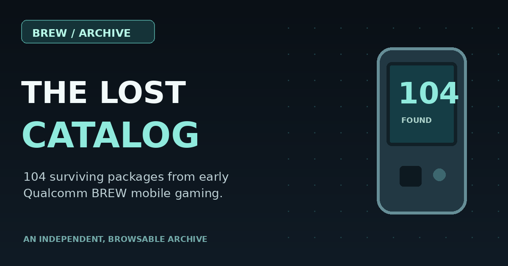

# Qualcomm BREW / The Lost Catalog

**A forgotten branch of mobile gaming, with a trail back to the files.**

[**Browse the BREW archive →**](https://wakkatobakka.github.io/qualcomm-brew-archive/) · [Sources and history](https://wakkatobakka.github.io/qualcomm-brew-archive/about/) · [Original collection](https://archive.org/details/qualcomm-brew-games)

Created and maintained by **Wakkatobakka**. Explore 104 preserved BREW packages through a searchable catalog of names, historical notes, original file listings, and package fingerprints.

## Explore the collection

- **104 package records:** 84 RAR files from `brew2010` and 20 ZIP files from `brew2018`.
- Searchable titles, package-type filters, and collection filters.
- An individual page for every package, including its original path, byte size, contents, and SHA-256 fingerprint.
- Historical introductions and source links, with uncertain identifications clearly labeled.
- [Catalog CSV](data/catalog.csv) and [complete metadata](data/catalog.json).

The collection includes demos, utilities, alternate display builds, and add-ons. Package counts are not counts of distinct retail games. The folder names `brew2010` and `brew2018` identify archive subsets; they are not verified game-release years.

## History with its evidence attached

All 104 records have descriptive introductions. The historical research is labeled according to what its sources establish:

| Research label | Records | What it establishes |
| --- | ---: | --- |
| Documented game history | 14 | Sources discuss the named mobile game; the archived binary's exact revision may remain unverified. |
| Related mobile history | 61 | Sources document a related franchise, edition, or publisher, rather than establishing authorship of that particular BREW binary. |
| Archive evidence only | 29 | The record relies on surviving package facts where adequate independent history was not found. |

The SHA-256 values identify original nested archive-entry bytes, even if a copy is renamed. A preserved package does not establish handset compatibility or playability. Associated studio credits are distinguished from verified credits for an exact BREW edition.

## Sources and credits

Original preserved files remain in the [Internet Archive Qualcomm BREW Games collection](https://archive.org/details/qualcomm-brew-games). Preservation credits belong to the original collectors and source community. Historical references appear on the individual records and the [Sources & story page](https://wakkatobakka.github.io/qualcomm-brew-archive/about/).

This repository contains the catalog, original presentation, and metadata. It does not bundle game binaries, protected game assets, private Android bridge sources, checkpoints, or signing material. Game copyrights and other third-party rights remain with their respective holders.

## Errors and broken links

Report an incorrect detail, missing credit, or broken link through [GitHub Issues](https://github.com/Wakkatobakka/qualcomm-brew-archive/issues). Include the title or record ID and a supporting source where possible. Wakka reviews reports and publishes any updates.

## More from Wakka's archive

[Qualcomm BREW](https://wakkatobakka.github.io/qualcomm-brew-archive/) · [Zeebo](https://wakkatobakka.github.io/zeebo-archive/) · [ExEn](https://wakkatobakka.github.io/exen-game-archive/) · [DoJa](https://wakkatobakka.github.io/doja-archive/)

---
Independent archival index by Wakkatobakka. No affiliation with Qualcomm or original game rights holders.
